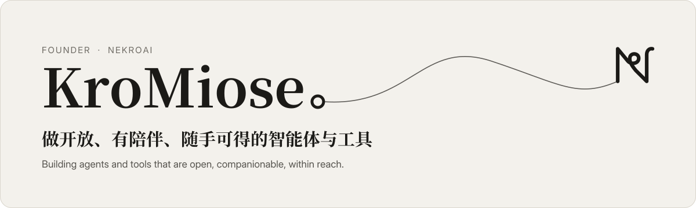
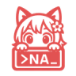

<picture>
  <source media="(prefers-color-scheme: dark)" srcset="assets/banner-dark.svg">
  
</picture>

  <a href="https://nekro.ai">nekro.ai</a> &nbsp;·&nbsp;
  <a href="https://github.com/NekroAI">NekroAI</a> &nbsp;·&nbsp;
  <a href="https://doc.nekro.ai">文档</a> &nbsp;·&nbsp;
  <a href="https://cloud.nekro.ai">社区</a>

你好，我是 KroMiose，[NekroAI](https://nekro.ai) 的发起人。从 2023 年的一个聊天插件开始，一路做到现在：开放、可扩展的智能体，陪伴在群聊里的伙伴，以及触手可及的日常工具。

Hi, I'm KroMiose, founder of NekroAI — open agents, companions for group chats, and everyday tools within reach.

## 正在做 Now

#### 智能体 Agents

 &nbsp;**[NekroNXT](https://nekro.ai/#nxt)** · 零代码、能自我进化的群聊智能体 &nbsp;[nxt.nekro.ai](https://nxt.nekro.ai) · [GitHub](https://github.com/NekroAI/nekro-nxt) 
 &nbsp;**[NekroAgent](https://nekro.ai/#nekro-agent)** · 开源的多人互动 Agent 框架 &nbsp;[GitHub](https://github.com/KroMiose/nekro-agent) · [文档](https://doc.nekro.ai)

#### 日常工具 Everyday tools

 &nbsp;**[Qantrip](https://nekro.ai/#qantrip)** · 按下 ⌃Q，几个字母展开完整提示词 &nbsp;[qantrip.nekro.ai](https://qantrip.nekro.ai) · [GitHub](https://github.com/NekroAI/qantrip) 
 &nbsp;**[TouchOS](https://nekro.ai/#touchos)** · 触控板上的可视化快捷面板 &nbsp;[GitHub](https://github.com/NekroAI/touchos) 
 &nbsp;**[纸鸢 Kitestring](https://nekro.ai/#kitestring)** · 风筝飞得再远，线在你手里 &nbsp;[GitHub](https://github.com/NekroAI/kitestring)

#### 边缘平台 On the edge

 &nbsp;**[NekroEndpoint](https://nekro.ai/#nekro-endpoint)** · 在边缘编排与分发 API 端点 &nbsp;[ep.nekro.ai](https://ep.nekro.ai) · [GitHub](https://github.com/NekroAI/nekro-endpoint) 
 &nbsp;**[Claude Code Nexus](https://nekro.ai/works#claude-code-nexus)** · 让 Claude Code 接入任意兼容接口 &nbsp;[claude.nekro.ai](https://claude.nekro.ai) · [GitHub](https://github.com/KroMiose/claude-code-nexus) 
 &nbsp;**[One Tracker](https://nekro.ai/works#one-tracker)** · 比较各家中转站的真实 Token 成本 &nbsp;[ot.nekro.ai](https://ot.nekro.ai) · [GitHub](https://github.com/NekroAI/one-tracker)

[全部作品 →](https://nekro.ai/works)

## 一路走来 Along the way

`2023` &nbsp;**Naturel GPT** · NoneBot 上的聊天插件，一切从这里开始 
`2024` &nbsp;**NekroAgent** · AI 在群聊中写代码、在沙盒中执行 
`2025` &nbsp;**平台与模板** · NekroEndpoint、Claude Code Nexus、One Tracker 
`2026` &nbsp;**NXT 与工具** · NekroNXT、Qantrip、TouchOS、纸鸢

## 数据 Stats

<picture>
  <source media="(prefers-color-scheme: dark)" srcset="https://nekro.ai/api/cards/github/dark.svg">
  
</picture>

<picture>
  <source media="(prefers-color-scheme: dark)" srcset="https://nekro.ai/api/cards/wakatime/dark.svg">
  
</picture>

让智能平等地抵达每一个人。 Intelligence, within reach of everyone.

